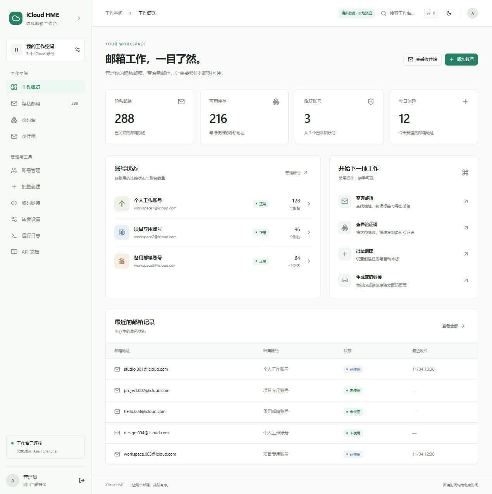
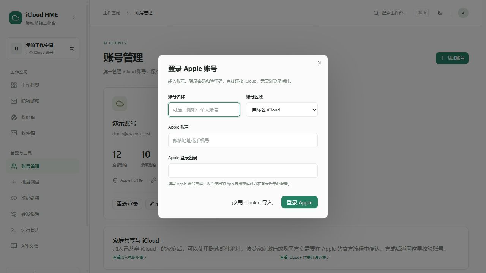

# iCloud HME Console

中文 iCloud「隐藏邮件地址」管理工作台，基于 Flask 与 React。集中管理多个账号的隐私邮箱、收件箱、验证码和取码链接，支持浅色/深色主题及手机布局。



## 功能

- **免插件登录**：直接输入 Apple 账号、登录密码和六位验证码，支持国际区/中国区及重新登录；Cookie 导入继续保留。
- **工作概览**：账号状态、别名数量、可用库存和创建记录。
- **隐私邮箱 / 收码台**：服务端分页、账号筛选、搜索、跨页选择、标签与备注、导出。
- **分栏收件箱**：列表与正文同时查看，跨账号邮件使用独立标识，验证码一键复制。
- **批量创建与调度**：多账号批量创建、分批补货配置、调度启停。
- **取码链接**：带令牌的独立取码页、随机标签地址、链接查询与撤销。
- **转发收件**：按 iCloud 账号绑定 QQ 或 Microsoft 邮箱；Microsoft 使用 OAuth2 授权。
- **运行日志**：搜索、级别筛选和旧日志清理。

新界面使用 React 19、TanStack Query、Tailwind CSS 4 与 Shadcn 组件，调用现有 Flask 接口。仓库包含已构建的前端，普通部署不需要 Node.js；修改界面时再安装前端开发依赖。

## 运行要求

- Python 3.11 或以上。
- 使用隐藏邮件地址功能的 iCloud+ 账号。
- 读取 iCloud 邮件时需要对应收件邮箱及 Apple App 专用密码。
- 前端开发：Node.js 22.12 或以上兼容版本，npm。

## 快速开始

```bash
git clone https://github.com/Gnsvip/icloud-hme-console.git
cd icloud-hme-console
python -m venv .venv
```

**Linux / macOS：**

```bash
source .venv/bin/activate
pip install -r requirements.txt
export ADMIN_USER=admin
read -rsp '设置后台密码: ' ADMIN_PASSWORD; echo
export ADMIN_PASSWORD
python web_ui.py --host 127.0.0.1 --port 5050
```

**Windows PowerShell 7：**

```powershell
.\.venv\Scripts\Activate.ps1
pip install -r requirements.txt
$env:ADMIN_USER = 'admin'
$env:ADMIN_PASSWORD = Read-Host '设置后台密码' -MaskInput
python web_ui.py --host 127.0.0.1 --port 5050
```

也可以通过系统环境变量或服务管理器设置密码。打开 [本地工作台](http://127.0.0.1:5050)，用刚设置的账号密码登录，再添加 iCloud 账号。

**没有内置后台密码。** 未设置 `ADMIN_PASSWORD` 时，Web 服务会拒绝启动。`.env.example` 仅用于说明环境变量，程序不会自动读取 `.env`。`ADMIN_SECRET_KEY` 可选；未指定时会在运行数据目录中生成随机签名密钥。

## 账号接入与收件



在「账号管理 → 添加账号」输入 Apple 账号、登录密码和六位验证码，无需安装插件。根据 Apple 返回的验证方式，验证码来自受信任设备或短信。已有账号可点击「重新登录」更新会话，保留收件邮箱、App 专用密码、备注及别名统计。

账号登录默认选择国际区，登录、连接重试及会话校验严格使用所选区域，不会自动切区。若 Apple 要求使用另一区域，工作台会明确提示并停止这次登录。验证码通过后若网络超时，可在这次登录的 10 分钟有效期内点击「继续连接」，不会重新提交验证码；网络中断与验证码错误分别提示。

服务器直连 Apple 不稳定时，可在服务环境中设置 `ICLOUD_PROXY_URL=http://127.0.0.1:7892`，使用已经配置并验证可用的 HTTP CONNECT 代理。该出口用于 Apple 登录、会话校验及 iCloud 隐藏邮件地址接口，保留 HTTPS 证书校验，不改变所选账号区域，也不改变 IMAP 或其他 HTTP 客户端的网络设置。代理节点与凭据由服务器管理，不写入仓库；未设置该变量时沿用原有连接方式。

Apple 登录密码用于连接账号；**App 专用密码用于 IMAP 收件**，需要在账号设置中另行填写，两者不能互换。尚未开通 iCloud+ 的账号可以先登录，工作台会提示开通或使用家庭共享后重新校验。

遇到 Apple 条款更新时，工作台会显示本次登录返回的条款全文和版本，以及需要单独确认的隐私告知。阅读后主动勾选并点击「同意并继续」才会提交确认；条款更新或缺失时不会自动接受，可以取消或重新加载。

登录通过第三方 [pyicloud](https://github.com/timlaing/pyicloud) 组件连接 Apple，并在导入前独立校验 iCloud 会话。安全密钥和旧版两步验证暂不支持直接完成，可点击「改用 Cookie 导入」使用手动 Cookie 或 [Cookie 助手](cookie-helper-extension/README.txt)。Apple 登录协议可能变化；当前已完成模拟回归与库适配测试，尚未使用真实 Apple 账号完成端到端验证。

「家庭共享与 iCloud+」卡片提供 [加入家庭](https://support.apple.com/zh-cn/108380) 与 [付费开通 iCloud+](https://support.apple.com/zh-cn/108349) 的官方步骤。接受邀请和支付由 Apple 的设备/客户端流程完成，本项目不自动接受家庭邀请或购买订阅。完成后点击账号「校验」更新隐藏邮件地址服务状态。

收件箱打开时读取本地缓存；点击「刷新」获取云端新邮件。指定地址查件期间不自动轮询，页面隐藏时暂停定时刷新。邮件正文按纯文本呈现，不加载邮件内的追踪图片。

取码链接包含访问令牌，持有者可以读取对应邮箱的验证码。可以在「取码链接」页面撤销访问。QQ 和 Microsoft 转发配置在「转发设置」中分别绑定到 iCloud 账号。

## 前端开发

```bash
cd frontend
npm ci
npm run build
npm test
```

构建输出位于 `static/admin-v2/`。开发服务器使用 5178 端口，并把 `/api` 和 `/c/` 转发到 5058 端口；开发时先在另一终端运行：

```bash
python web_ui.py --host 127.0.0.1 --port 5058 --no-sync
```

随后在 `frontend/` 下运行 `npm run dev`。开发和生产环境都使用同一套登录鉴权。

## 验证与性能

```bash
pip install pytest
python -m pytest tests -q
```

测试覆盖缓存批量保存、写入失败重试、并发缓存、库存无变化不写盘、分页与账号过滤、登录保护、刷新失败保留数据、后台暂停轮询，以及跨账号相同邮件编号的正文隔离。

历史回归测试已按现有接口更新，并加入写入失败、并发、超时取消、缓存清理和懒加载验证。每次推送或 PR 由 GitHub Actions 自动检查，详见 [测试说明](docs/testing.md)。

主要性能改动：正文批量落盘、无变化跳过写入、库存与缓存原子替换、库存文件及查询缓存、服务端分页、页面懒加载、哈希静态资源长期缓存。约 20 MB 合成缓存新增 30 封正文从 30 次写盘降到 1 次；1593 条库存连续 5 次相同同步从 5 次写盘降到 0 次。耗时因机器与负载而异，不代表真实邮件网络请求速度。

## 部署与数据

建议在反向代理后运行 Waitress，并通过 HTTPS 访问后台。保留 `/api/`、`/static/` 和 `/c/` 的正确转发。使用 systemd 等服务管理器时，以环境变量传入后台密码，将项目目录设为工作目录。

免插件登录使用进程内的短期流程，推荐保持单进程 Waitress 部署；多进程部署必须将同一次登录固定路由到同一进程。升级后重新安装 `requirements.txt`。每个登录流程有效 10 分钟，同时最多 8 个流程、2 个后台登录任务。每步有 90 秒期限，并设置连接/读取超时；系统 DNS 或第三方库的不可中断操作可能延迟实际退出。

Apple 登录密码不写入账号文件，登录完成、失败、取消或过期后释放登录组件及临时目录；进行中的网络调用退出后完成清理。登录组件的临时会话文件仅在该流程内使用，普通退出会清理；强制终止进程或系统断电时，系统临时目录中可能有残留。保存到账号中的 iCloud Cookie 和已有 App 专用密码继续按原方式保存。

运行时账号、Cookie、邮件缓存、取码令牌和配置可能存于项目根目录的 JSON 文件及 `results/`；日志存于 `logs/`。这些内容已由 `.gitignore` 排除，不应提交到仓库。备份时同时保留运行数据和签名密钥，升级时只替换代码与前端资源。

本地邮件副本从缓存写入时间起保留 30 天；启动、后续写入及访问时的每小时检查会清理过期内容。旧缓存在首次升级时开始计算期限。每账号最多保留 500 条收件箱记录、5000 条别名邮件（每别名 50 条）及 1000 份正文；列表内容与正文内容各有 16 MiB 上限。只清理本地副本，不删除云端邮件或库存备注；需要时可再次从邮箱获取。相关上限集中在 `mail_cache.py`。

库存使用临时文件、刷新磁盘后原子替换；文件损坏时停止库存写入并返回错误，保留原文件供恢复。日志文件继续按原有期限清理，旧界面使用的内存队列仅保留最近 2000 条。

普通 IMAP 查询最多同时运行 4 项、等待 4 项；取码查询最多同时运行 16 项、等待 16 项，相同地址的并发请求共享任务。排队时间计入超时，超时任务会关闭已建立的 IMAP socket，过期的排队任务不会继续查询。连接阶段有单独的网络超时；操作系统 DNS 解析等不可中断调用不保证能即时终止，但不会无限接收新任务。

原版 HTML/JS 界面保留在 `templates/` 与 `static/js/`。没有 `static/admin-v2/index.html` 时，应用回退到原界面。

## 目录

```text
frontend/                 React 前端源码与测试
static/admin-v2/           已构建的新前端
routes/                   Flask 路由
services/                 收件、库存、补货等业务逻辑
templates/                取码页与原后台模板
cookie-helper-extension/  Cookie 导入辅助扩展
tests/                    后端测试
web_ui.py                 Web 服务启动入口
app_core.py               共享配置、鉴权与调度
mail_cache.py             邮件缓存
inventory_manager.py      库存管理
```

## 许可证与致谢

项目延续原版 README 标注的 MIT 许可，见 [LICENSE](LICENSE)。基础 UI 组件来自 [Shadcn Admin](https://github.com/satnaing/shadcn-admin)，其版权与 MIT 许可证保留在 [第三方许可证](frontend/public/shadcn-admin-LICENSE.txt)。收件箱布局由本项目实现。

本项目为独立工具，与 Apple Inc. 无隶属关系。
